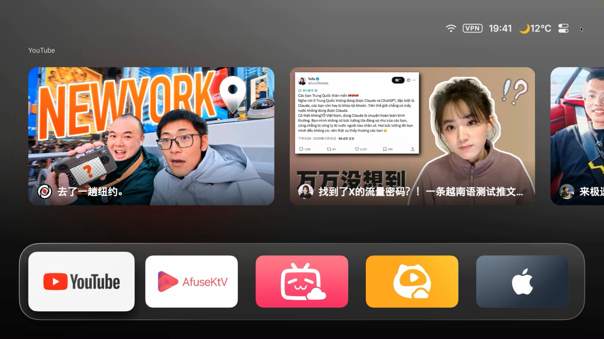
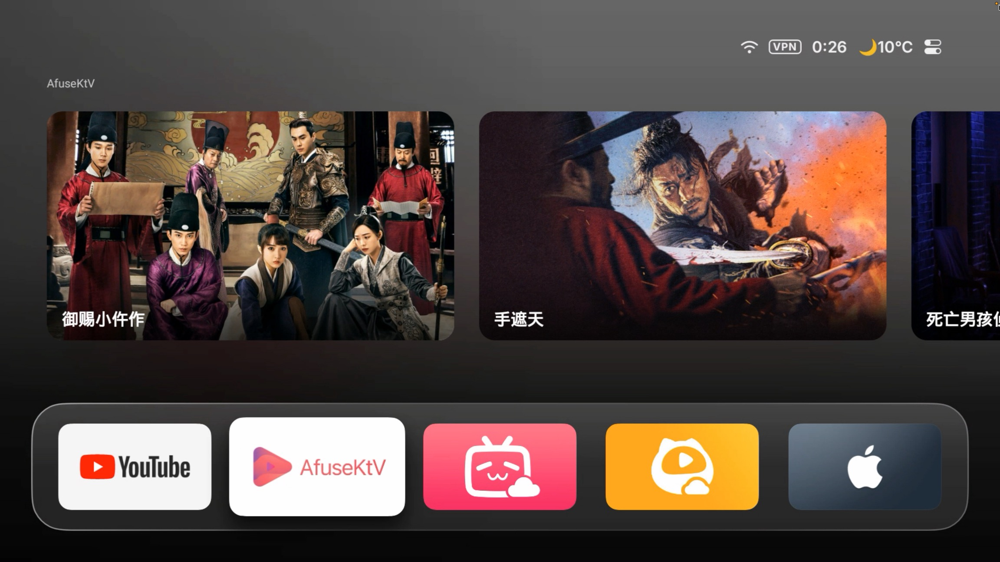

# 📺 CleanYourTV 懒人版

### Aerial + CleanYourTV，二合一，一次装好。

**一块干净的电视桌面，加上一个能瘦身的系统。**

[下载 APK](#安装) · [独占功能](#独占功能) · [对比](#对比) · [致谢](#致谢)




<p align="center"><em>索尼 KD-43X85K 电视实拍 —— 打开电视就是这样：Top Shelf 大卡片在上，玻璃底板在下</em></p>

---

## 独占功能

下面这些，Aerial 和 CleanYourTV 原版都没有，只有这个版本有。

### 🍎 Top Shelf 大卡片

桌面第一排上方的大卡片行，三种内容按优先级来：

**App 自带的功能卡片 > 自己填的图片链接 > App 自己的海报图**

再加上四个订阅源，卡片直接在桌面上刷出来、按确认直接进：

- **YouTube 订阅**：手机上加频道，最多 30 个频道、30 张卡，汇成一池按时间排，每频道至少保一条最新；也支持关键词模式，每个关键词至少保三条
- **哔哩热门**：哔哩热门榜
- **虎牙直播**：只上真正在播的房间，按当前人气取前 30
- **资深影迷**：见下

|  |  |
| :---: | :---: |
| YouTube 订阅 | 哔哩热门 |
|  |  |
| 虎牙直播 | AfuseKtV |

### 🎬 资深影迷：今日趋势 + 预告片

TMDB 今日趋势，电影和电视剧，20 部轮播，8 秒换一张：

- 剧照只取无语言、1920×1080 以上的，随机挑一张，只下这一张
- 海报上按确认直接播预告片（跳 YouTube App，优先中文预告片）
- 评分两路：IMDb 分（OMDb）+ 烂番茄影评人分 / 观众分（Trakt）
- 平台图标按优先级排，最多显示 9 个，多出折成 +N
- 屏保里也是它，全屏轮播，左右可切

|  |  |
| :---: | :---: |
| 桌面：带 Dock 与状态胶囊 | 屏保：全屏轮播 |

### 📡 信号源：不用切就能看

第一排的信号源（HDMI、电视直播等）聚焦时直接全屏预览画面，不用真的切过去；同时左边的时钟隐藏，右上角胶囊显示时间 + 天气。

### 🧹 系统瘦身：电视上直接做

不用电脑、不用敲命令，电视上打开瘦身页就能停用系统自带应用，一键停用、一键恢复：

- 清单按电视型号联网现拉
- 页面直接显示 ADB 授权状态，没授权时按钮不可点，并告诉你去哪开
- 后悔了可以恢复


<p align="center"><em>按型号现拉的清单：建议停用 31 个、自选 22 个，一键停用，后悔药一键恢复</em></p>

### 📦 两个包 + 软件内更新

- **标准版**：可设为默认桌面（索尼等大多数电视）
- **NoHome 版**：给装不上桌面类 App 的电视（部分 TCL、海信），靠无障碍服务接管主页键，开机自动进
- 新版发布后电视自己提示更新，更新说明只显示更新日志那一段

### 📱 手机页：拿手机改设置

手机和电视连同一 Wi-Fi，浏览器打开 `http://<电视 IP>:8799` 就能改设置：加 YouTube 订阅频道、给第一排 App 换背景图、改天气密钥……不用在电视上打字。

### 🖼️ 第一排 App：自定义背景 + 换图标

- dock 里的 App 聚焦时显示你指定的背景图（像 Apple TV），图片地址自己填，不打包进 APK
- App 图标也能换：一个 App 多个精选图，点哪个换哪个

### 🌦️ 天气 + 屏保

- **天气**：和风 + 默认源，emoji 显示；今天、明天、后天、大后天预报 + 天气预警
- **屏保**：航拍、视频、资深影迷、待机显示（纯黑时钟，白天纯白、夜里 18:00–06:00 暗红）

|  |  |
| :---: | :---: |
| 航拍壁纸：俯瞰地球 | 航拍屏保：途经太平洋上空 |

### 📺 机型适配

微鲸 CEC 唤醒、创维剪贴板替身、各品牌设置页与 Home 键修法……持续跟原版同步，覆盖越来越多机型。

---

## 对比

先看一眼换桌面之前和之后：

|  |  |
| :---: | :---: |
| 电视原装首页 | Aeria-CleanYourTV |

|  | Aeria-CleanYourTV（我们） | Aerial | CleanYourTV |
|---|---|---|---|
| **定位** | 桌面 + 瘦身，二合一 | 电视桌面 | 电视桌面 + 瘦身 |
| **电视桌面** | ✅ | ✅ | ✅ |
| **系统瘦身** | ✅ | ❌ | ✅ |
| **瘦身怎么做** | ✅ 电视本身即可，电脑更方便 | ❌ | 工具跑 `pm` 命令；launcher 须自己编译 |
| **Top Shelf 大卡片** | ✅ 功能卡片 / 自定义图 / 订阅 | ❌ | ❌ |
| **资深影迷 / 预告片** | ✅ | ❌ | ❌ |
| **订阅卡片（YouTube / 哔哩 / 虎牙）** | ✅ | ❌ | ❌ |
| **天气** | ✅ 定位精准，接入和风，数据详细，恶劣天气提醒 | ❓ 定位经常错误 | 插件提供 |
| **屏保 / 壁纸** | ✅ 与 Aerial 一致 | ✅ 航拍 4K /  | ✅ 主题 + 屏保插件 |
| **信号源免切换预览** | ✅ 不切信号源全屏预览 | ✅ 需要设为壁纸 | ❌ |
| **图标** | 官方图标 + 多个精选图可换 | 联网拉远程图标 | — |
| **语言** | 只留中 / 英 | 中 / 英 / 哈 / 俄 / 乌 | 31 种 |
| **最低安卓** | 5.0+ | 5.0+ | 8.0+ |
| **安装** | 安装 APK | 安装 APK | 自己编译后装；社区有预编译 APK |
| **包名** | com.gathin.slimtv | app.orchard.tv | com.gathin.tvhome |
| **更新** | 软件内更新 | 覆盖安装 | — |
| **CEC 自动切信号源** | ✅ | ✅ | — |
| **输出设备** | ✅ | ✅ | — |
| **覆盖 TV 型号** | ❓ 太老的可能会有 BUG | ✅ 更新频率高 | ✅ 更新频率高 |

---

## 安装

电脑和电视连同一个网络。不用 root。

### 1. 打开电视的 ADB 调试

设置 → 设备偏好设置 → 关于 → 连按「内部版本号」7 次，再在开发者选项里打开「USB 调试」（有无线调试的也打开）。电视的 IP 在「设置 → 网络 → 已连接的网络」里。第一次连接时电视会问是否允许调试，选「始终允许」。

### 2. 选一个 APK

两个包是同一个软件，只差桌面声明，按电视选一个（链接永远指向最新版）：

| 电视 | 下载 |
|---|---|
| 📺 支持换桌面（大多数电视，如索尼） | [](https://github.com/alienwaregf/Aeria-CleanYourTV/releases/latest/download/Aeria-CleanYourTV.apk) |
| 📺 不支持换桌面（装不上桌面类 App，如部分 TCL、海信） | [](https://github.com/alienwaregf/Aeria-CleanYourTV/releases/latest/download/Aeria-CleanYourTV-NoHome.apk) |

然后装到电视上（文件名换成你下的那个）：

```bash
adb kill-server && adb start-server && adb connect <电视IP>:5555
adb -s <电视IP>:5555 install -r Aeria-CleanYourTV.apk
```

装完按主页键，进的就是 CleanYourTV 懒人版。无 HOME 版靠无障碍服务接管主页键，开机自动进。

---

## 致谢

- **[pengchujin/aerial-tv](https://github.com/pengchujin/aerial-tv)**：Aerial 桌面本体（MIT 协议）。没有它，就没有这个桌面。
- **[Gathin23/cleanyourtv](https://github.com/Gathin23/cleanyourtv)**：CleanYourTV 瘦身清单数据与思路。电视型号的瘦身清单（如 `sony-bravia-4k-vh2`）来自这个仓库的 `examples/`。
- **Flow Launcher**：Top Shelf 大卡片的灵感来源（闭源，仅 Releases 发 APK）。
- **Hume Launcher**：TMDB「资深影迷」轮播的灵感来源。
- 壁纸与航拍影片来自 Apple TV 与必应，版权归各自所有者。

<p align="center"><em>本页所有界面均为索尼 KD-43X85K 电视实拍</em></p>
